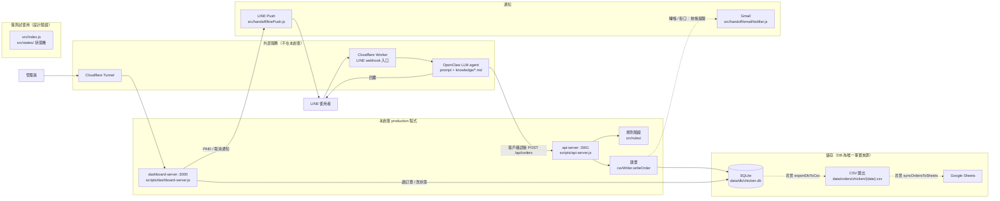

# 雞味研究所 LINE 客服系統 (Chicken Customer Service)

本專案為生鮮熟食團購品牌「雞味研究所」開發的 LINE 官方帳號智能客服與訂單處理系統。專案整合規則引擎、有限狀態機（FSM）、SQLite 核心儲存、Google Sheets 非同步同步機制，以及 Gmail / LINE 雙通道管理員通知備援，負責處理客戶詢問、訂單意圖識別、配送時段/區域校驗與訂單生命週期管理。

> **專案狀態說明**：本專案開發與演進已告一段落（目前架構穩定收斂至 Round 43），已進入封存與暫停日常維護狀態。倉庫內容保留完整業務代碼、單元測試、自動化同步腳本與架構決策紀錄（ADR）。

---

## 系統架構與工作流程

系統由兩部分組成。對客戶說話的是 OpenClaw 上的 LLM agent，行為由 prompt（`docs/production-prompt/latest/`）與知識庫（`knowledge/tenants/chicken/`）決定。本倉庫在 production 實際執行的是兩個 HTTP 服務，`scripts/api-server.js`（:3001）與 `scripts/dashboard-server.js`（:3000），以及它們引用的 `src/rules/`、`src/order/`、`src/storage/`、`src/handoff/` 模組。

`src/index.js` 與 `src/states/` 的有限狀態機只由測試呼叫，用途是把 prompt 的對話流程寫成可 unit test 的規格（見 [ADR-0001](docs/adr/0001-src-not-production-runtime.md)）。



實線是同步呼叫，虛線是 `setImmediate` 背景觸發。

### 核心運作鏈路說明

1. **對話**：LINE 訊息經 Cloudflare Worker 送進 OpenClaw agent。agent 依 `SOUL.md`、`AGENTS.md`、`main_idea.md` 行事，商品、價格、配送、付款等事實按情境讀取 `knowledge/tenants/chicken/01~12_*.md`。
2. **建單（B 方案）**：客戶二次確認後，agent 呼叫 api-server 的 `POST /api/orders`（見 `config/tenants/chicken.yaml` 的 B 方案段落）。api-server 先用 `src/rules/` 驗證開團日、時段、菜單、電話與三鶯配送範圍，再呼叫 `writeOrderWithRetry`。
3. **寫入鏈（Round 43 架構）**：`writeOrder` 寫入 SQLite（`src/storage/db.js`），成功後在背景執行 `exportDbToCsv()` 依配送日重新產生 CSV，再由 `src/storage/sheetsSync.js` 以 service account JWT 推送到 Google Sheets。付款方式為轉帳或街口時，另寄核帳提醒信。
4. **轉真人**：production 由 LLM agent 依 `knowledge/tenants/chicken/07_transfer_rules.md` 的 14 種情境判斷並通知管理員。`src/handoff/transferRules.js` 與 `notifier.js` 是同一套規則的程式化版本，只在測試中執行。
5. **管理後台**：管理員經 Cloudflare Tunnel 開啟 dashboard。dashboard 從 DB 讀訂單，狀態改為 PAID 或 CANCELLED 時寫回 DB，並以 LINE Push 通知客戶。

### 已知限制

- **兩條更新路徑**：dashboard 的 `POST /api/orders/:id/status` 寫 DB，但 api-server 的 `PATCH /api/orders/:id`、收據分析，以及 dashboard 另外三個更新 endpoint 呼叫 `csvWriter.updateOrder`，只改 CSV。`exportDbToCsv` 會從 DB 整份覆寫 CSV，所以只寫進 CSV 的更新會在下一次匯出時遺失。
- **Sheets 可能落後**：dashboard 改狀態後直接觸發 `syncOrdersToSheets`，沒有先匯出 CSV，Sheets 要等下一次匯出才會更新。
- **讀取來源不一致**：api-server 的 `GET /api/orders` 讀 CSV，dashboard 讀 DB。
- **prompt 與 src/ 可能漂移**：`src/` 是 prompt 邏輯的測試版本，修改其中一邊時必須同步另一邊。

---

## 核心模組與目錄結構說明

```text
├── config/                     # 租戶業務設定
│   └── tenants/chicken.yaml    # 雞味研究所專屬設定（營業時間、開團日、門檻、轉真人規則）
├── data/                       # 本地資料儲存
│   ├── db/                     # SQLite 資料庫目錄（chicken.db，已由 .gitignore 排除）
│   └── orders/chicken/         # 自動匯出的 CSV 訂單檔案與受保護歷史資料
├── docs/                       # 專案手冊、決策紀錄 (ADR) 與測試報告
│   ├── adr/                    # 架構決策紀錄 (0001-0005)
│   ├── reports/                # E2E 整合、業務驗證與操作手冊
│   ├── DICTIONARY.md           # 模組與路徑字典
│   ├── GMAIL_SHEETS_WORKFLOW.md# Gmail 及 Google Sheets 鏈路專門文件
│   └── NEW_SESSION_HANDBOOK.md # 維運接手與排查手冊
├── knowledge/tenants/chicken/  # 結構化業務知識庫 Markdown (01_product 到 12_reply_examples)
├── scripts/                    # 獨立運行的服務程式與自動化維運腳本
│   ├── api-server.js           # REST API 服務（提供訂單建立、更新、驗證與查詢）
│   ├── dashboard-server.js     # 管理後台服務（支援 Basic Auth、X-API-Token 與即時圖表）
│   ├── run-tests.sh            # 測試執行守門腳本（強制啟用 NODE_ENV=test 避免誤發通知）
│   ├── sheets-sync-cron.js     # 排程用 Google Sheets 同步命令
│   └── sync-runtime.sh         # L1 開發環境到 L3 運作環境的知識庫與 Prompt 同步腳本
├── src/                        # 專案核心原始碼
│   ├── config.js               # 設定載入器（YAML 解析、降級 fallback 與 Feature Flag 管理）
│   ├── handoff/                # 轉真人與通訊通知模組
│   │   ├── autoOrder.js        # 嚴格純文字「確認」觸發自動建單
│   │   ├── emailNotifier.js    # Gmail OAuth 2.0 寄件與日/週報彙總
│   │   ├── linePush.js         # 客戶端 LINE Push 推播 API 包裝
│   │   ├── notifier.js         # 管理員通知（LINE Push 與 Email 雙通道備援與節流）
│   │   ├── receiptAnalyzer.js  # 轉帳與街口付款截圖分析邏輯
│   │   └── transferRules.js    # 13 種轉真人業務規則與語意評估
│   ├── knowledge/              # 知識庫載入與意圖判定 (loader.js, triggers.js)
│   ├── middleware/             # 中介軟體（whitelist.js 提供測試期間白名單檢查）
│   ├── order/                  # 訂單處理與格式化
│   │   ├── csvReader.js        # 歷史 CSV 讀取與用戶查詢
│   │   ├── csvWriter.js        # SQLite 訂單同步轉出 CSV (exportDbToCsv)
│   │   ├── orderFormatter.js   # LINE 卡片純文字格式化與金額運算
│   │   └── orderIdGenerator.js # ORD-YYYYMMDD-XXX 與 PENDING 流水號產生器
│   ├── rules/                  # 業務規則檢驗引擎（地址、電話、菜單、時段、日期、金額）
│   ├── states/                 # 有限狀態機 (FSM) 各狀態處理實作
│   ├── storage/                # 資料持久化
│   │   ├── db.js               # SQLite (better-sqlite3) CRUD、表結構與索引維護
│   │   └── sheetsSync.js       # Google Sheets API v4 JWT 簽章同步
│   ├── tools/orderStatus.js    # 提供外部 LLM 查詢訂單狀態的即時工具
│   └── utils/                  # 工具庫（結構化 Logger、輸入消毒 Sanitizer、時區、LINE 回覆）
└── tests/                      # 測試套件（Node.js 內建測試與斷言，涵蓋規則、狀態機、儲存層）
```

---

## 環境變數配置說明

程式碼中實際引用的 `process.env` 參數彙整如下。請依運行需求在環境變數或 `.env` 檔案中配置：

### 1. 核心網路與基礎服務
| 變數名稱 | 預設值 | 說明 |
|---|---|---|
| `PORT` | `3001` (API) / `3000` (Dashboard) | 伺服器監聽 Port |
| `NODE_ENV` | 無 | 設為 `test` 時會全面阻斷真實 LINE Push 與 Gmail 寄送 |
| `CHICKEN_TEST_NO_SEND` | 無 | 設為 `1` 時強制阻斷通知外部呼叫（測試專用防護） |
| `ALLOW_TIMEZONE_OVERRIDE`| 無 | 預設強制使用 `Asia/Taipei`，設為 `1` 允許覆寫時區 |
| `TENANT_ID` | `chicken` | 租戶識別代碼，決定讀取的配置與資料夾路徑 |
| `LOG_LEVEL` | `info` | 記錄層級：`debug` (10), `info` (20), `warn` (30), `error` (40) |
| `LOG_DIR` | `null` | 設定後會將 `warn` 與 `error` 層級日誌寫入該目錄的每日 `.log` 檔 |

### 2. API Server (`scripts/api-server.js`)
| 變數名稱 | 預設值 | 說明 |
|---|---|---|
| `API_USERNAME` | `api-user` | API Server HTTP Basic Auth 使用者名稱 |
| `API_PASSWORD` | 空字串 | API Server HTTP Basic Auth 密碼 |
| `API_PASSWORD_FILE` | 無 | 自外部檔案載入 API 密碼（避免密碼外露於行程清單） |
| `API_RATE_LIMIT` | `60` | 每一 IP 於時間窗內的請求上限次數 |
| `API_RATE_LIMIT_WINDOW_MS`| `60000` | 速率限制時間窗（毫秒） |
| `API_GRACEFUL_TIMEOUT_MS` | `10000` | 接收到中斷訊號後的正常關機寬限時間（毫秒） |
| `API_CORS_ORIGINS` | 空字串 | 允許的 CORS Origin 清單（逗點分隔） |
| `X_API_TOKEN` / `API_TOKEN` | 無 | 內部服務通訊用的 Token |
| `X_API_TOKEN_FILE` / `API_TOKEN_FILE` | `~/.config/chicken/secrets/api-token` | 讀取內部通訊 API Token 的檔案路徑 |
| `MOCK_TODAY` | 無 | 測試環境模擬當前日期時間（ISO 8601 格式，生產環境嚴禁設置） |

### 3. Dashboard Server (`scripts/dashboard-server.js`)
| 變數名稱 | 預設值 | 說明 |
|---|---|---|
| `DASHBOARD_USERNAME` | `admin` | 管理後台 HTTP Basic Auth 帳號 |
| `DASHBOARD_PASSWORD` | 空字串 | 管理後台 HTTP Basic Auth 密碼 |
| `DASHBOARD_PASSWORD_FILE`| 依序嘗試 `/home/clawuser/.config/chicken/secrets/dashboard-pwd` 與 `/tmp/dash-pwd` | 管理後台密碼檔案路徑 |
| `DASHBOARD_URL` | `https://dashboard.brt1122.com/` | 產生於通知信件中的管理後台回訪網址 |
| `WORKER_HEALTH_URL` | `https://external-user-line-security.kaden1122123.workers.dev/api/knowledge/stats` | 後台健康檢查所監控的 Cloudflare Worker 端點 |

### 4. 通訊整合（LINE / Gmail / OpenClaw Gateway）
| 變數名稱 | 預設值 | 說明 |
|---|---|---|
| `LINE_BOT_TOKEN` | 無 | LINE Messaging API Channel Access Token |
| `LINE_BOT_TOKEN_FILE` | 依序讀取 `~/.config/chicken/secrets/line-bot-token` 與 `/tmp/line-bot-token` | 自指定檔案讀取 LINE Bot Token |
| `LINE_CHANNEL_SECRET` | 無 | LINE Channel Secret |
| `JKO_QR_CODE_URL` | 無 | 街口支付收款 QR Code 圖片公開連結 |
| `OPENCLAW_GATEWAY_URL`| `http://127.0.0.1:18789` | OpenClaw Gateway 端點（用於 Vision 圖片辨識） |
| `KNOWLEDGE_CACHE_TTL_MS`| `30000` | 知識庫檔案解析快取有效時間（毫秒） |

---

## 本地啟動與測試指令

本專案基於 **Node.js 22**（定義於 `.nvmrc`）。請先安裝相依套件：

```bash
npm ci
```

### 1. 執行測試

所有測試均整合安全守門機制，測試期間自動注入 `NODE_ENV=test` 與 `CHICKEN_TEST_NO_SEND=1`，防止向外部 API 發出真實請求或產生實際扣款/寄件：

```bash
# 執行全部單元測試（透過 scripts/run-tests.sh 依序執行 tests/*.test.js）
npm test

# 執行全套測試（包含 tests/*.test.js 與 scripts/dashboard-server-test.js）
npm run test:all

# 程式碼品質與語法規範檢查 (ESLint)
npm run lint

# 自動修復部分 ESLint 語法格式問題
npm run lint:fix
```

針對特定業務模組進行單獨測試：

```bash
npm run test:rules              # 規則引擎檢驗（電話、地址、菜單、時段、付款方式）
npm run test:states             # 狀態機流程轉換測試
npm run test:handoff            # 轉真人條件與語意匹配測試
npm run test:security           # 輸入消毒、SQL/Prompt Injection 防護測試
npm run test:date               # 開團日期計算與截止邊界測試
npm run test:config             # 設定載入與 YAML 降級解析測試
npm run test:whitelist          # 白名單過濾機制測試
npm run test:integration        # Worker 攔截模擬整合測試
npm run test:api-server         # API Server HTTP 端對端整合測試 (需 3457 Port)
npm run test:time-utils         # 時間運算與時段解析測試
npm run test:line-reply         # LINE 訊息輸出格式測試
npm run test:order-id           # 訂單流水號產生器測試
npm run test:order-formatter    # 訂單文字排版與金額計算測試
npm run test:csv-reader         # CSV 解析與查詢功能測試
npm run test:notification-format# 管理員通知卡片排版測試
npm run test:dashboard-server   # 後台 Server API 整合測試
```

### 2. 本地服務啟動

手動啟動核心 API 服務：

```bash
# 啟動 API Server (Port: 3001)
API_USERNAME=api-user \
API_PASSWORD=your_api_password \
node scripts/api-server.js

# 啟動 Dashboard 管理後台 (Port: 3000)
DASHBOARD_USERNAME=admin \
DASHBOARD_PASSWORD=your_dashboard_password \
node scripts/dashboard-server.js
```

---

## 專案歷史與維護狀態

本專案歷經 40 餘個開發回合（Rounds）之迭代重構，自初期以 CSV 直寫為主的實驗架構，逐步演進為具備 SQLite 事務保障、動態表頭 Google Sheets 同步映射、完整 29 欄位稽核結構之團購客服解決方案。

目前系統進入**封存狀態（Archived / Paused）**。系統現況如下：
- **核心業務邏輯**：穩定運行於 Node.js 22 環境，所有主要路徑皆有獨立測試案例覆蓋（CI 通過 60+ 個測試套件）。
- **外部依賴**：Google Sheets 與 Gmail 依賴 GCP 憑證金鑰，LINE 串接依賴 Channel 憑證。相關私密金鑰檔案（位於 `~/.config/chicken/secrets/`）均未且不得納入 Git 版本控管。
- **維護指南**：如需重新啟用或檢視詳細架構演進歷史，請參閱 `docs/reports/` 內所屬之架構驗證報告與 `docs/adr/` 之架構決策紀錄。